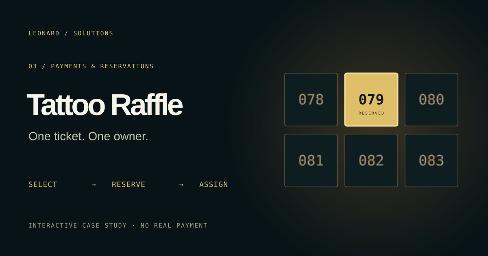
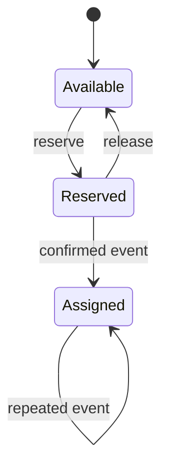

# Tattoo Raffle · one ticket, one owner



A self-contained case study of the ticket selection and reservation experience I built for a real tattoo campaign. Visitors can choose numbers, reserve or release them, confirm a **simulated** checkout and replay the confirmation event to inspect idempotency.

**[Try the live demo](https://leonardsolutions.dev/demos/tattoo-raffle)** · [Portfolio](https://leonardsolutions.dev/#work)

> **Portfolio edition.** All names, tickets and events are fictional. The demo runs in the browser and does not connect to Stripe, Resend, Supabase or production customer records. It never charges a card or sends an email.

## What to try

1. Select up to ten available numbers or choose a package.
2. Reserve them. They move from **available** to **reserved**.
3. Release the reservation and see the numbers become available again, or confirm a simulated checkout.
4. Replay the confirmation event: assigned tickets and the purchase count do not change.

On small screens, browse ticket ranges or search for a number. The sandbox persists for one browser session and has a **Reset** control. Spanish and English are supported.

## Implementation



- `src/domain/pricing.ts` is the package-pricing module from the private product, included with permission. The UI derives prices from it instead of trusting an editable price from the browser.
- `src/domain/raffle.ts` is a browser-only state machine for the portfolio experience. It validates ticket counts and availability, and tracks processed event IDs.
- `src/domain/raffle.test.ts` checks reservation, release, confirmation, replay and pricing.
- `src/RaffleDemo.tsx` and `src/DemoStory.tsx` provide the participant interface, event view and scroll story.

**Production boundary:** real checkout totals must be calculated on the server. Ticket uniqueness must be enforced transactionally, and a signed payment webhook must authorize assignment. This demo deliberately has no payment or email endpoint.

## Run locally

Requires Node.js 22+ and pnpm 10+.

```bash
pnpm install
pnpm dev
```

No credentials or environment variables are needed. Verification:

```bash
pnpm lint
pnpm test
pnpm build
```

## My contribution

I built the participant flow and supporting reservation, checkout and confirmation logic for the original campaign. This public repository shows the pricing module and an independently runnable reconstruction of the key experience, rather than a production payment system or its customer database.

## Resumen en español

Caso de estudio interactivo de una campaña real. Selecciona números, resérvalos, libera la reserva o confirma un pago simulado. Repite el evento para comprobar que no se asignan entradas dos veces. Los datos son ficticios y no existen conexiones con servicios de pago, correo o clientes.

Source is publicly viewable; no reuse license is granted for the code, brand or assets.
